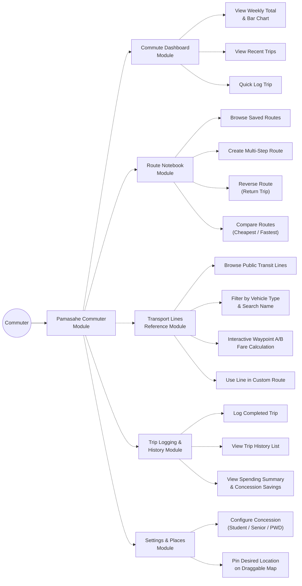

# Pamasahe — Use Case Diagram & Specification

## 1. How to Generate Your Diagram Image

### Option A: Using Mermaid Live Editor (Fastest — 10 seconds)
1. Go to **[mermaid.live](https://mermaid.live/)** in your browser.
2. In the left panel ("Code"), paste the **Mermaid Diagram Code** from Section 2 below.
3. The visual use case diagram will instantly render on the right.
4. Click **Actions** > **Download PNG** or **Download SVG** to save the image for your documentation or slides.

### Option B: Using Draw.io (app.diagrams.net)
1. Go to **[app.diagrams.net](https://app.diagrams.net/)**.
2. Click **Arrange** (in the top menu) > **Insert** > **Advanced** > **Mermaid**.
3. Paste the code below and click **Insert**.
4. You can now edit shapes, move nodes around, and style them to match your instructor's sample.

---

## 2. Mermaid Diagram Code (Copy & Paste)

---

## 3. Module & Feature Summary Table (For Report / Defense)

| Module | Core Features (`<<include>>`) | Optional / Extended Features (`<<extend>>`) |
| :--- | :--- | :--- |
| **1. Commute Dashboard (Home)** | • View Weekly Spending Total • View 7-Day Expense Bar Chart • View Recent Commute Trips | • Quick "Log Trip" Action • Open Detailed Spending Analytics |
| **2. Route Notebook** | • Browse Saved Commute Routes • Create Multi-Step Commute Route • View Detailed Route Timeline | • Auto-Fill Step from Catalog Line • Reverse Route (Return Trip) • Compare Routes (Cheapest & Fastest) |
| **3. Transport Line Catalog** | • Browse Public Transport Lines • View Stops Timeline & Details • Calculate Segment Waypoint Fares | • Filter by Vehicle Type & Search • Interactive A/B Waypoint Selection • Export Line to Custom Route • Add / Edit / Delete Custom Lines |
| **4. Trip Logging & History** | • Log Completed Commute Trip • View Chronological Trip History | • View Weekly/Monthly Spending Analytics • View Concession Savings Insight |
| **5. Settings & Customization** | • Toggle Concession Discount (20%) • Select Category (Student/Senior/PWD) • Manage Saved Places List | • Pin Place on Draggable Map (Shopee/Foodpanda style) • Quick Transit Hub Presets • Live Coordinate & Address Lookup |
