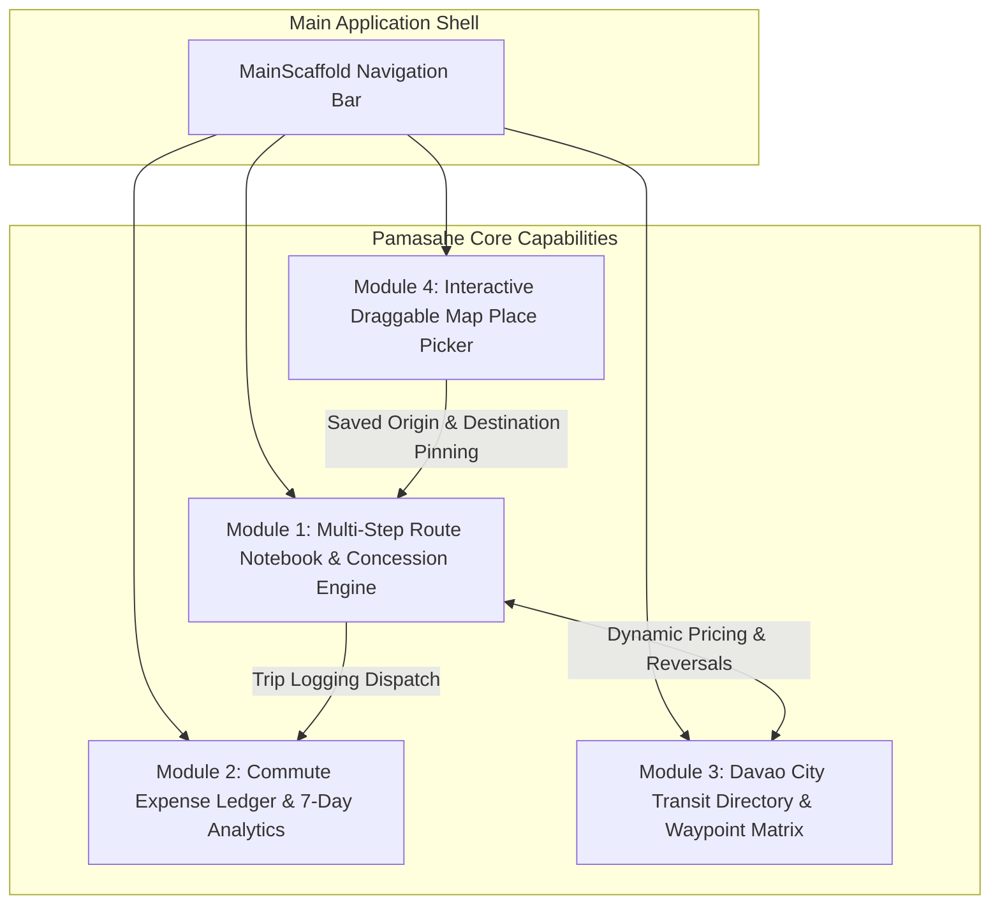
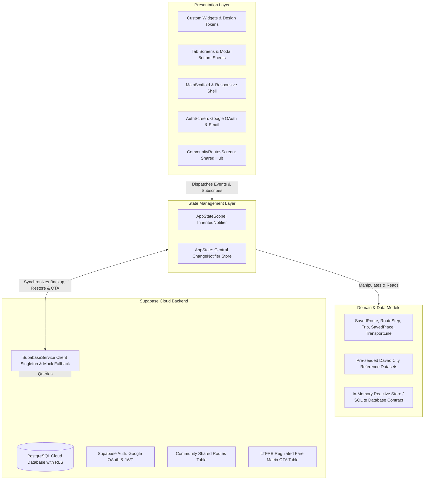

# CHAPTER 1: CONCEPTUALIZING THE MOBILE APPLICATION

**Course:** CCE 106 — Mobile Application Development  
**Academic Level:** 3rd Year, 1st Semester (2nd Term)  
**Project Title:** Pamasahe — Davao City Commuter Companion & Fare Tracker  
**Platform:** Flutter / Dart (Cross-Platform Mobile Application)  

---

## 1.1 Introduction

Urban commuting within Philippine metropolitan centers presents a complex logistical and financial puzzle for everyday passengers. In cities like Davao City, commuters rely on a decentralized, heterogeneous public transit ecosystem consisting of traditional Public Utility Jeepneys (PUJs), modernized Public Utility Vehicles (Bulaong / Modern PUVs), City and Provincial Commuter Buses, UV Express vans, tricycles, and localized multicabs. While veteran commuters internalize the intricacies of these interconnected transit networks through years of trial and error, new commuters—especially university students moving into the city, daily workers, and infrequent travelers—face severe cognitive friction. Commuters are frequently confronted with ambiguous routes, unstandardized transfer hubs, unpredictable multi-leg transit fares, and an absence of clear financial accounting for their daily travel expenses.

**Pamasahe** is an offline-first, commuter-centric mobile application conceptualized and built with the **Flutter** framework and **Dart**. Designed specifically as a personal commute notebook, statutory concession fare calculator, and urban transit directory, Pamasahe empowers commuters to record and organize multi-step journeys, calculate segment-by-segment and cumulative fares with legally mandated concession discounts, access a curated catalog of authentic Davao City transit routes, and monitor commute expenditures against strict weekly and monthly budgets. By prioritizing offline autonomy, zero-friction data logging, and tailored local transit realities, Pamasahe transforms daily commuting from a source of stress into an organized, transparent, and financially predictable routine.

---

## 1.2 Purpose and Value Proposition

### 1.2.1 The Core Problem Statement
Navigating Philippine public transportation reveals four distinct, interconnected challenges:

1. **Information Asymmetry in Multi-Leg Commutes:** Unlike cities with unified metro lines and synchronized schedules, Philippine cities rely on fragmented transfer routes. A typical student commute from Toril or Mintal to the University of Mindanao (UM Matina) or Ateneo de Davao University often involves multiple disconnected transit steps (e.g., a tricycle to the highway terminal, an express jeepney to a major crossing, and a short modern PUV or pedestrian walk to the university campus). Commuters struggle to remember exact transfer waypoints, boarding points, and respective segment tariffs.
2. **Fare Unpredictability and Budget Slippage:** Commuters frequently experience "micro-spending leaks," where small individual fares (₱15, ₱22, ₱35) accumulate into substantial, unmonitored monthly expenditures. Students and minimum-wage earners rarely know their true monthly transit costs, leading to unexpected budget depletion prior to allowances or paydays.
3. **Lack of Concession Fare Transparency:** Under Philippine law, eligible commuters are entitled to a mandatory 20% fare discount. However, manually calculating the discounted rate across varying multi-step base fares (accounting for minimum fare distances, additional per-kilometer fees, and fractional centavo rounding rules) is tedious and prone to overcharging or underpayment during fast-paced fare collections inside crowded vehicles.
4. **Fragility of Network-Dependent Navigation:** Mainstream global transit and navigation applications (such as Google Maps or Waze) depend heavily on persistent high-speed mobile internet connectivity, heavy background GPS processing, and cloud services. During peak rush hours, cell tower congestion and patchy cellular data connections frequently render web-dependent applications sluggish or completely unresponsive. Furthermore, international transit tools lack localized knowledge of informal jeepney terminals, landmark-based transfer stops (e.g., "Bangkal Central", "Matina Crossing", "Bankerohan Bridge"), and statutory fare matrices.

### 1.2.2 Value Proposition & Solution Benefits
Pamasahe resolves these challenges through an **offline-first personal transit ledger and reference companion**:

* **Personalized Route Memory:** Commuters save the exact custom travel paths they use. Rather than recalculating a route from scratch each morning, users maintain a curated library of personal routes with customized boarding points, transit modes, and negotiated or regular fares.
* **Instant Statutory Concession Engine:** The application implements automated 20% concession calculations compliant with Philippine statutes:
  * **Republic Act No. 11314** (*Student Fare Discount Act*)
  * **Republic Act No. 9994** (*Expanded Senior Citizens Act*)
  * **Republic Act No. 10754** (*Act Expanding the Benefits and Privileges of Persons with Disability*)
  With a single global toggle, the entire application dynamically recalculates base fares and displays cumulative statutory savings.
* **Offline-First Resilience:** Pamasahe stores and processes all commuter data locally on the client device. It requires no user accounts, no remote database authentication, and zero cellular data consumption, guaranteeing instantaneous load times and 100% operational reliability whether underground, inside remote terminals, or during network outages.
* **Proactive Commute Budgeting:** Equipped with a visual 7-day spending bar chart, monthly allowance progress bars, and one-tap trip logging, commuters gain immediate visibility into their transportation costs, preventing transport budget overruns before they happen.

### 1.2.3 Strategic Differentiation from Existing Solutions
To highlight the distinctive value of Pamasahe, the table below contrasts its architectural and functional scope against conventional transit platforms:

| Evaluation Dimension | Mainstream Navigation (Google Maps / Waze) | Commercial Transit Engines (Sakay.ph) | **Pamasahe (This Project)** |
| :--- | :--- | :--- | :--- |
| **Primary Paradigm** | Turn-by-turn vehicle GPS routing | Algorithmic A-to-B route discovery | **Personal Commute Notebook & Financial Ledger** |
| **Connectivity Dependency** | 100% Online (Cloud & GPS mandatory) | High Online Dependency (Backend Routing API) | **100% Offline-First (Client-Side Independence)** |
| **Data Sovereignty & Privacy**| Centralized user location tracking | Cloud account tracking & telemetry | **Zero Cloud Tracking; Local Device Storage** |
| **Multi-Leg Fare Calculation** | Not supported for local informal transit | Algorithmic estimated fares | **Exact User-Customizable Step-by-Step Fares** |
| **Concession Fare Engine** | None | Limited / Generalized | **Statutory 20% Discount Engine (RA 11314, 9994, 10754)** |
| **Expense & Budget Analytics**| None | None | **Integrated 7-Day Chart, Budget Tracker & Logs** |
| **Local Urban Fidelity** | Generic road coordinates | Metro Manila centric | **Tailored Davao City Lines & Landmark Waypoints** |

---

## 1.3 Target Audience

The design, usability, and technical characteristics of Pamasahe are specifically formulated to address the constraints, habits, and technical environments of daily urban commuters.

### 1.3.1 Primary User Persona: The Student Commuter

The primary audience for Pamasahe comprises senior high school, college, and university students (aged 16 to 24) navigating urban educational corridors and commuting daily between surrounding suburban districts and major academic institutions across Davao City. Operating under rigid weekly allowances where public transit fares consume up to half of their liquid budget, these commuters rely on Pamasahe's offline route recording, instant statutory 20% student fare discounting, and proactive budget threshold alerts.

### 1.3.2 Secondary User Persona: Statutory Concession Beneficiaries & Daily Workers

The secondary audience encompasses senior citizens, Persons with Disabilities (PWDs), and low-to-middle income daily wage workers navigating recurring transit corridors across Davao City's commercial centers. These users benefit directly from Pamasahe's statutory Senior and PWD concession calculations under Republic Acts 9994 and 10754, high-contrast Material 3 typography, and automated one-tap route reversals for daily round trips.

---

## 1.4 Core Functionalities

To achieve its objectives, Pamasahe incorporates four primary interconnected modules:

### 1.4.1 Feature 1: Multi-Step Route Notebook & Statutory Fare Engine
* **Description & Purpose:** Allows commuters to assemble, store, customize, and audit complex journeys comprised of multiple consecutive transit steps (e.g., Step 1: Tricycle from Neighborhood to Highway; Step 2: Modern PUV from Crossing to Downtown; Step 3: Pedestrian Walk to Campus Gate).
* **Operational Flow:**
  1. The user inputs a human-readable Route Name (e.g., "Home to UM Matina Campus") and selects pinned From and To locations.
  2. For each leg, the user specifies the transit mode (`RideType`: Traditional Jeepney, Modern PUV, City Bus, UV Express, Tricycle, Walking/Transfer), the specific Boarding Point, the travel duration, and the standard base fare in Philippine Pesos (₱).
  3. The engine aggregates all segment costs into a cumulative base fare.
  4. If the concession toggle is active, the engine automatically applies a 20% discount across every qualifying segment, rendering both the standard total and the discounted total with explicit statutory savings.
  5. **Automated Return Route Reversal:** With a single tap on the "Reverse Route" action, the system clones the route, swaps origin and destination, inverts the step sequence, and appends a "(Return)" signifier, saving the user from redundant manual entry.
  6. **Route Comparison Screen:** Allows commuters to select multiple saved paths connecting common terminal zones to compare them side-by-side, immediately highlighting the "Cheapest" and "Fastest" options.
* **Unique Interactions & UX:**
  * Smooth step re-ordering and interactive fare preview cards.
  * Outdated fare visual warning chips if route tariffs have not been reviewed within 90 days.
  * Modal bottom sheet for rapid transit step creation with vehicle-specific iconography and color badges.
* **Flutter Implementation & Widgets:**
  * `ListView.separated` and `Card` widgets configured with clean border radii and contextual vehicle icon badges (`RideIconBadge`).
  * `AnimatedSwitcher` and `AnimatedCrossFade` for seamless transitions between standard and discounted fare totals.
  * Form validation via `TextFormField` with reactive error strings ensuring zero negative or non-numeric fare values.

### 1.4.2 Feature 2: Commute Expense Ledger & 7-Day Spending Analytics Dashboard
* **Description & Purpose:** Functions as an automated financial ledger that records commute expenses, visualizes expenditure trends, and benchmarks cumulative spending against user-defined weekly and monthly budgets.
* **Operational Flow:**
  1. **Quick-Log Action:** From the primary dashboard or route details screen, the commuter taps "Log Trip". The system prefills the selected route's name, timestamp, and pre-calculated fare (reflecting active concession status).
  2. The commuter can confirm the entry with a single tap or adjust the amount paid (e.g., if unusual traffic surcharge or detour occurred).
  3. The transaction is instantly appended to the chronological `trips` ledger using an immutable copy-on-write pattern (preserving historic amounts even if the underlying route fare is later modified).
  4. The dashboard recalculates total weekly expenditures (Monday through Sunday) and updates the dynamic 7-day spending chart.
  5. The budget progress meter calculates current utilization against the commuter's budget threshold (e.g., ₱115.00 spent of ₱150.00 weekly budget), dynamically shifting from brand teal to caution amber or alert coral as limits are approached.
* **Unique Interactions & UX:**
  * Interactive period switching between "This Week" and "This Month" views.
  * Tactile modal sheets displaying category breakdowns, trip counts, and cumulative concession pesos saved.
  * High-visibility top notification banners confirming trip logs with undo actions.
* **Flutter Implementation & Widgets:**
  * Custom mathematical drawing algorithms in Dart coupled with styled container bars for the 7-day expense chart.
  * `LinearProgressIndicator` wrapped in a themed card displaying real-time budget percentages.
  * `Dismissible` widgets within the trip history tab allowing intuitive swipe-to-delete gestures for mistakenly recorded entries.

### 1.4.3 Feature 3: Davao City Public Transit Line Directory & Interactive Waypoint Fare Matrix
* **Description & Purpose:** Serves as a curated, authentic offline reference catalog of major public transportation routes across Davao City (including iconic lines such as Route 02 Matina, Route 04 Buhangin, Route 08 Toril, Route 10 Ecoland, and Calinan Express).
* **Operational Flow:**
  1. The user navigates to the "Transit Lines" tab and browses official routes filtered by vehicle classification (Traditional PUJ, Modern Blue Bus, or City Express Bus).
  2. Opening any route reveals a complete vertical stop-by-stop transit timeline (e.g., Toril Terminal $\rightarrow$ Puan $\rightarrow$ Ulas $\rightarrow$ Bangkal $\rightarrow$ Matina Crossing $\rightarrow$ Bolton $\rightarrow$ Roxas Ave).
  3. **Interactive Waypoint A/B Matrix:** The user selects any boarding stop (Stop A) and any destination stop (Stop B) directly on the timeline. The underlying distance calculation model dynamically computes the segment distance and returns the exact regulated fare for that specific segment.
  4. **Import to Route:** The commuter can tap "Use Line in Route" to import that transit line's segment directly into their personal multi-step route builder without manual typing.
* **Unique Interactions & UX:**
  * Custom vertical timeline painter with continuous line indicators and circular waypoint nodes.
  * Segment selection chips that highlight the travel corridor between Stop A and Stop B.
  * Search bar with real-time text query filtering across route codes, terminal names, and intermediate street landmarks.
* **Flutter Implementation & Widgets:**
  * `CustomScrollView` and `SliverAppBar` providing smooth scrolling performance over extensive transit lists.
  * `Wrap` and `ChoiceChip` widgets for zero-lag vehicle type filtering.
  * Interactive modal bottom sheets for waypoint selection and fare confirmation.

### 1.4.4 Feature 4: Interactive Draggable Map Place Picker (Slippy OpenStreetMap Canvas)
* **Description & Purpose:** Enables commuters to pin critical personal landmarks (e.g., "Home", "Campus Gate", "Boarding Point", "Work") directly onto an interactive geographical map canvas to establish origin and destination anchors.
* **Operational Flow:**
  1. The user opens the Place Picker from Settings or Route Creation.
  2. The application renders an interactive slippy map canvas utilizing high-resolution OpenStreetMap (OSM) and Esri tile layers.
  3. A floating center teardrop pin remains anchored to the screen center while the user pans and drags the map beneath it.
  4. Real-time reverse-geocoding compares current center coordinates against an embedded database of Davao landmarks (e.g., Ateneo de Davao, UM Matina, SM Ecoland, Bankerohan Public Market, DCOTT Bus Terminal), automatically updating the address and suggested location name.
  5. Commuters can choose from one-tap shortcut buttons for major Davao transit hubs or manually refine the name and category before saving.
* **Unique Interactions & UX:**
  * Fluid drag-and-pan gestures with inertia and smooth spring-back animations when releasing the center pin.
  * Layer switching between OpenStreetMap Full Detail, Esri Detailed Street Map, and Clean Light Gray styles.
  * Zoom controls with dual gesture support (pinch-to-zoom and floating action buttons).
* **Flutter Implementation & Widgets:**
  * Custom `GestureDetector` bound to transformation matrices calculating latitude/longitude from screen-space tile offsets using Web Mercator projections.
  * `Stack` combining the tile layer canvas, animated center pin widget, floating hub shortcuts, and sliding bottom location confirmation sheet.

### 1.4.5 Feature 5: Supabase Cloud Synchronization & Multi-Factor User Authentication
* **User Value & Problem Solved:** Satisfies academic and institutional cloud integration requirements while providing students with peace of mind. Commuters risk losing their painstakingly recorded route networks, custom fares, and historical spending ledgers if their phone is replaced, damaged, or wiped.
* **Functional Description & Workflow:**
  1. The commuter navigates to the Settings Tab and views the Supabase Cloud card.
  2. Commuters can authenticate via Email/Password or one-tap Google Sign-In (`OAuth 2.0`), or continue in Guest/Offline mode.
  3. Authenticated commuters can trigger a one-tap "Backup Now" action, which serializes all local saved routes, waypoints, pinned places, and historical trip logs and synchronizes them to a hosted PostgreSQL database on Supabase.
  4. On a new device or fresh install, tapping "Restore" pulls the commuter's saved transit profile down from the cloud.
* **Technical Resilience & Offline-First Design:**
  * Pamasahe implements an offline-first architectural pattern. If internet connectivity is unavailable or live cloud keys are unconfigured, `SupabaseService` gracefully falls back to an offline mock mode. The application remains 100% operational, and all unit/widget tests execute without network dependencies.
* **Security & Row-Level Security (RLS):**
  * PostgreSQL tables (`profiles`, `saved_places`, `commute_routes`, `route_steps`, `trip_logs`) enforce strict Row-Level Security (RLS) policies guaranteeing that commuters can only read, insert, update, or delete their own data (`auth.uid() = user_id`).

### 1.4.6 Feature 6: Crowdsourced Community Routes & Over-The-Air (OTA) Fare Updates
* **User Value & Problem Solved:** Davao City commuters often struggle to navigate unfamiliar jeepney lines or find optimal transfers. Furthermore, when the LTFRB issues fare adjustments, hardcoded transit catalogs become outdated.
* **Functional Description & Workflow:**
  1. **Community Route Feed:** Commuters can open the Community Routes screen from the Routes Tab, browsing popular crowdsourced transit paths shared by fellow students (e.g., "Toril to Ateneo Roxas Express", "Matina to Abreeza Mall via Bankerohan").
  2. **1-Tap Route Import:** Commuters can inspect any community route's step-by-step jeepney/bus transfers, estimated travel time, and fare breakdown, and import it directly into their personal Route Notebook with a single tap.
  3. **Share My Route:** Commuters can publish their favorite customized shortcuts to the public community repository to help other students navigate Davao City.
  4. **Over-The-Air (OTA) Fare Sync:** In the Transit Lines tab, commuters can tap "Sync Fares", querying Supabase for the latest LTFRB regulated fare matrix and updating line notes, base fares, and per-km rates over-the-air without requiring an app store update.

---

## 1.5 Technical Feasibility & Flutter Elements

### 1.5.1 Architecture & Technical Overview
Pamasahe is built using a clean, layered architectural pattern engineered for predictability, testability, offline resilience, and seamless cloud integration:

* **Target Framework:** Flutter SDK `^3.5.0` / Dart SDK `^3.13.5` with strict typing and modern sound null safety.
* **Backend & Cloud Database:** Supabase (`supabase_flutter: ^2.18.3`) powering PostgreSQL cloud storage, Row-Level Security (RLS) data protection, Google OAuth authentication, crowdsourced community transit sharing, and Over-The-Air (OTA) fare matrix updates.
* **Form-Factor Shell (`PhoneFrame`):** To ensure a consistent mobile experience during development, web demonstrations, and tablet testing, the application encapsulates its layout inside a responsive phone frame shell matching modern 390x844 mobile viewport proportions with graceful scaling on larger screens.
* **Zero Bloat & Offline Graceful Degradation:** Core operations run entirely locally on device without network latency. Cloud services enhance the experience without making network access a hard blocker.

### 1.5.2 Leveraging Flutter's Native Capabilities
1. **Declarative Widget Hierarchy & Composition:**
   Flutter’s declarative UI paradigm enables Pamasahe to construct complex user interfaces out of highly focused, reusable widgets. For example, the `MainScaffold` utilizes an `IndexedStack` to host the five core tabs (`HomeTab`, `RoutesTab`, `LinesTab`, `HistoryTab`, `SettingsTab`). This guarantees that each tab’s state, scroll positions, and text inputs are completely preserved in memory when switching between views without unnecessary rebuild overhead.
2. **Reactive State Management via `InheritedNotifier` & `ChangeNotifier`:**
   Rather than introducing complex external state management libraries (such as Bloc or Redux), the project implements a clean, standard architecture leveraging `ChangeNotifier` (`AppState`) encapsulated within an `InheritedNotifier` (`AppStateScope`). 
   * When a commuter toggles the concession discount or logs a trip, `AppState.notifyListeners()` triggers selective, localized widget rebuilds exclusively for subscribed UI nodes via `AppStateScope.of(context)`.
   * This provides $O(1)$ lookup performance, eliminates boilerplate code, and guarantees smooth 60fps rendering even on entry-level mobile devices.
3. **Custom Canvas Rendering & Gesture Subsystems:**
   The interactive OpenStreetMap slippy canvas and the 7-day spending chart showcase Flutter's low-level graphics pipeline. By capturing raw pointer events through `GestureDetector` and translating geographic coordinates via Mercator mathematical transformations, the application delivers smooth interactive panning and zooming without requiring costly native platform map wrappers.

### 1.5.3 Anticipated Technical Challenges & Mitigation Strategies

| Anticipated Technical Challenge | Root Cause & Risk | Applied Mitigation Strategy in Pamasahe |
| :--- | :--- | :--- |
| **1. Data Persistence & Historical Integrity** | If past trip logs reference live route records, subsequent route or fare edits would inadvertently alter historical spending totals. | **Copy-on-Write Historic Logging:** When a trip is logged, the `Trip` model creates an immutable snapshot of `amountPaid`, `routeName`, and timestamp. Deleting or editing parent routes never mutates historical ledger entries. The schema is pre-architected with `ON DELETE SET NULL` contracts for SQLite integration. |
| **2. Concession Rounding Discrepancies** | Applying a flat 20% discount across non-standard fares often yields fractional centavos (e.g., ₱13.00 × 0.80 = ₱10.40), whereas public transport operators may apply rounding rules. | **Transparent Concession Representation:** All calculations utilize explicit 2-decimal floating point math, rendering the statutory discount clearly alongside the exact standard fare. The UI explicitly alerts commuters that calculations are accurate legal estimates compliant with RA 11314. |
| **3. Offline Map & Landmark Resolution** | Full-scale vector map SDKs (e.g., Google Maps SDK) demand API keys, billing configurations, and active network connections for geocoding. | **Hybrid Tile Caching & Embedded Geo-Features:** The application incorporates an embedded database of Davao City coordinates, transit terminals, and landmark radiuses. Reverse-geocoding occurs instantly on-device through Euclidean distance comparison, with graceful fallback tile loading for visual navigation. |
| **4. UI Performance during Rapid State Changes** | Heavy rebuilds across complex lists of multi-step routes during real-time filtering or rapid period switching can drop frames. | **Indexed Component Stacking & Selective Repainting:** Tab views persist using `IndexedStack`, list items use `ListView.builder` for virtualized viewport rendering, and state updates isolate mutation notifications to affected components only. |

---

## 1.6 Summary

Chapter 1 establishes the conceptual framework, functional scope, and engineering architecture of **Pamasahe**. By bridging the gap between informal Philippine public transit realities, statutory fare regulations, and practical personal budgeting, Pamasahe provides a modern, robust, and accessible mobile tool tailored for the daily commuter. Through its offline-first architecture, intuitive multi-step route notebook, integrated 7-day analytics, authentic Davao City transit directory, and native Flutter implementation, the project proves both technically feasible and profoundly beneficial to its target user base.
